# ROCm CI work queue: design and results

How the ROCm CI runs its GPU tests since [PR #696](https://github.com/ROCm/TransformerEngine/pull/696)
(merged to `dev` on 2026-11-09 as `8a28a45fa`), why, and what it changed. Every number comes from
GitHub Actions runs between 2026-08-27 and 2026-11-09; [Appendix A](#appendix-a-methodology) says
how they were measured.

Kept out of scope, for separate PRs: the size of the CI Docker image, and running mGPU items side
by side on one box.

## Contents

1. [Summary](#1-summary)
2. [How CI ran before](#2-how-ci-ran-before)
3. [Goals and non-goals](#3-goals-and-non-goals)
4. [Design](#4-design)
5. [The optimizations](#5-the-optimizations)
6. [Results in production](#6-results-in-production)
7. [Operating notes](#7-operating-notes)
8. [Limitations and next steps](#8-limitations-and-next-steps)
9. [Appendices](#appendix-a-methodology)

## 1. Summary

The single-GPU (sGPU) tests used to run one suite per GPU: torch on one GPU, JAX on another, core
and the examples on the other two. The torch GPU decided the wall clock, and the four GPUs were busy
about half the time. Now every test invocation is a work item in one queue, the longest items start
first, and each GPU takes the next item as soon as it is free.

On top of the queue, a re-run repeats only what failed, down to single tests. A pull request runs
only the suites its changes can affect. Setup and capability probes run once per job, before the
queue starts.

| | Before | After |
|---|---|---|
| sGPU GPU utilisation | median 48% at level 3, 53% at level 1 | **99.7–100%** with learned weights, 86–96% without |
| Same items on the same machine | 1x | **2.4x faster** (median of 22 runs, range 1.9–2.9x) |
| sGPU test step at level 3 (median) | mi30x 165 min, mi35x 168 min | mi30x **74 min**, mi35x **105 min** (with learned weights) |
| Level 3 runs killed at the 240 min step timeout | 39 of 357 (11%) | **0 of 32** |
| "Re-run failed jobs" on an sGPU job (median) | 142 min: every suite again | **16 min**: only the failed tests (3 min of testing) |
| dev push to its last GPU job | 4.9 h (median of 74 pushes) | **2.9 h** (first push after the merge) |
| PR runs that need only some suites | every run ran everything | **23%** of PR runs, 10% of sGPU GPU-hours (replay of the new rules) |

Test coverage is unchanged: the queue runs the same test invocations, with the same arguments and
environment, as the suite scripts always did. Two single-GPU tests moved from the mGPU job to the
sGPU queue ([§5.11](#511-changes-to-the-suite-scripts)).

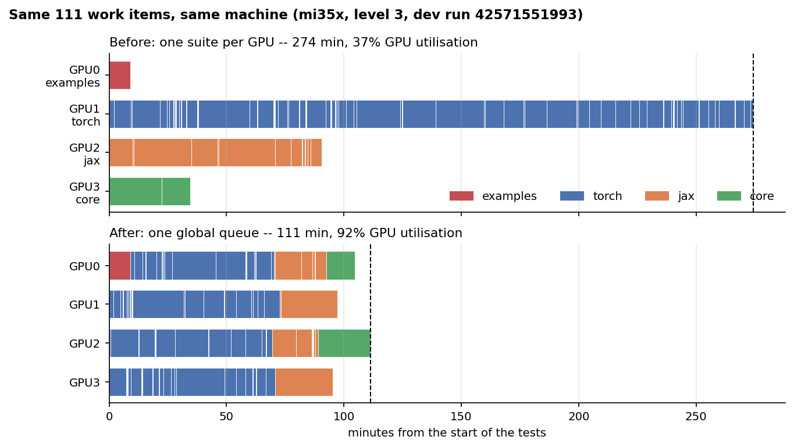

*The first dev run after the merge (mi35x, level 3). Top: its 111 items laid out the old way, each
suite end to end on its own GPU. Bottom: the queue's actual schedule. Same items, same durations:
274 min becomes 111 min. This run had no learned weights yet; [§5.2](#52-longest-first-from-learned-weights)
shows what they add.*

## 2. How CI ran before

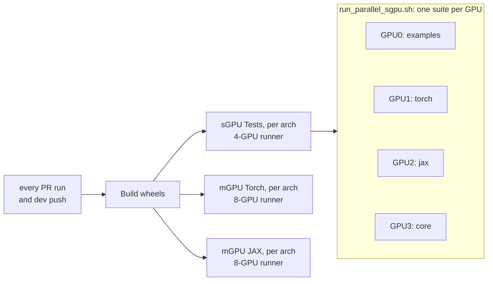

The problems, measured on the runs of the old layout:

- **The longest suite set the wall clock.** torch was the longest suite in 260 of 322 runs, JAX in
  the rest. When the shorter suites finished, their GPUs sat idle: median utilisation was 48% at
  level 3 and 53% at level 1.
- **The longest suite outgrew the step timeout.** At level 3, 39 of 357 runs (11%) were killed at
  the 240 min limit of the test step, losing the results still in flight.
- **Every PR ran every suite**, whatever it changed.
- **"Re-run failed jobs" repeated the whole job.** One flaky test cost another 142 min (median).
- **Setup ran inside each suite.** torch and JAX each built the CK JIT cache, at the same time and
  into the same directory.

## 3. Goals and non-goals

Goals:

- Shorten the sGPU tests without changing which tests run.
- Use every GPU until the work runs out, at 4 GPUs today or 8 later, with no per-box configuration.
- Keep the suite scripts the single source of truth for what runs; keep per-suite logs, exit codes
  and JUnit reports.
- Make a failed run cheap to repeat, and make the same commands work outside CI.

## 4. Design

### 4.1 Workflow

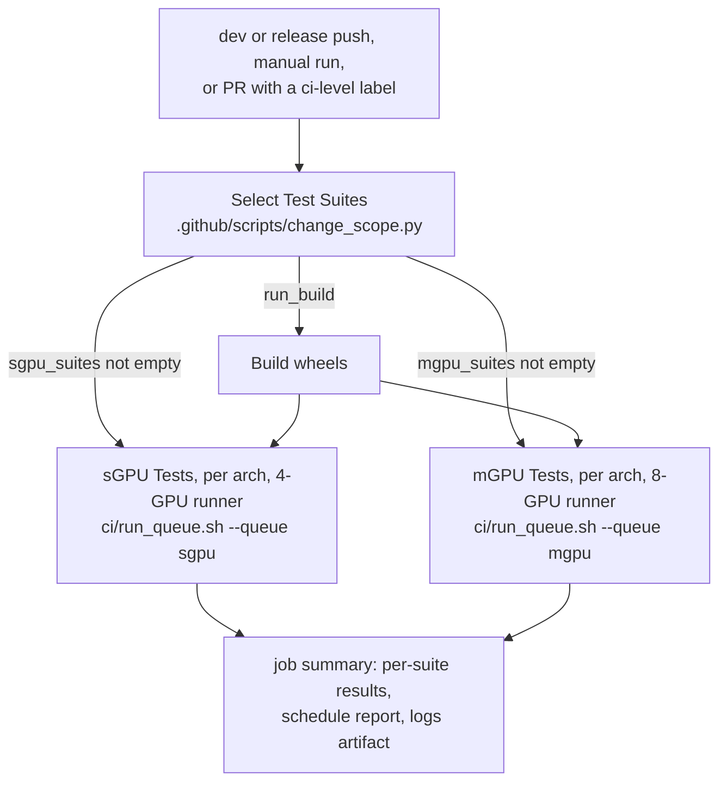

One script, [`ci/run_queue.sh`](../../run_queue.sh), drives both test jobs. The suite selector
passes it the suites to run; a job with none is skipped. The mGPU torch and JAX jobs became one job
per arch, which runs its items one after another, each on the whole box.

### 4.2 Work items

A suite script is a list of test invocations: `pytest_run` call lines in `ci/pytorch.sh` and
`ci/jax.sh`, each with its own environment prefix, backend and `-k` filter. Each invocation is a
**work item**, named by the tag its JUnit file already used, for example
`test_numerics.ck.amax+triton`.

| Suite | Script | Mode | Items at level 3 (mi35x) |
|---|---|---|---:|
| examples | `.github/scripts/run_examples.sh` | opaque: one item | 1 |
| torch | `ci/pytorch.sh` | list | 90 |
| jax | `ci/jax.sh` | list | 18 |
| core | `ci/core.sh` | list: `nongemm`, `gemm` | 2 |
| torch-mgpu, jax-mgpu | the same scripts, `TEST_MGPU=1` | list | 23 |

The queue configs, [`ci/ci_sgpu_queue.conf`](../../ci_sgpu_queue.conf) and
[`ci/ci_mgpu_queue.conf`](../../ci_mgpu_queue.conf), list the suites; the scripts list the items.

### 4.3 Inside `run_queue.sh`

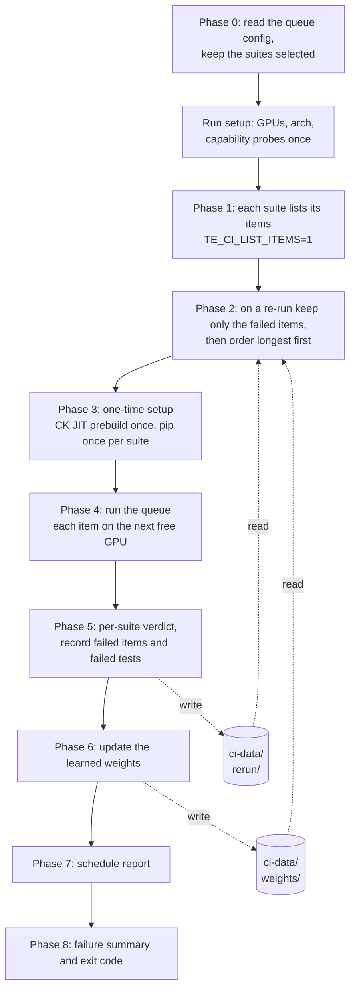

The workflow restores `ci-data/weights/` and `ci-data/rerun/` from the Actions cache before the
queue starts and saves them after it ends ([§7.3](#73-caches)).

### 4.4 Dispatch by re-entry

The queue never builds a pytest command itself. It asks each suite script for its items, then runs
the same script again once per item, with a filter that lets exactly one call line through:

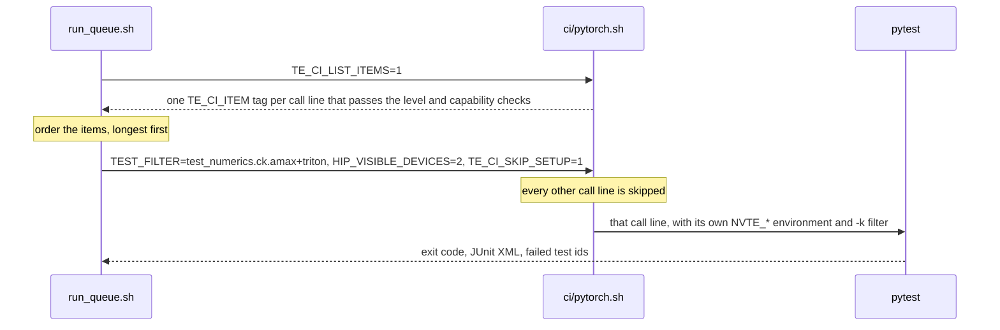

The tag is the only thing that crosses from the scheduler to the suite, so an item cannot lose its
configuration on the way: the line that runs it is the line the suite script always ran. Level
gating, the fused-attention backend matrix and capability probes stay in the suite scripts.

## 5. The optimizations

### 5.1 One global queue

| | |
|---|---|
| Problem | One indivisible suite per GPU: the GPU with torch decides the wall clock, the others go idle. |
| Change | A queue of ~110 items at level 3; each GPU takes the next item as soon as its last one ends. |
| Effect | The same items finish 1.9–2.9x sooner (median 2.4x); see the figure in [§1](#1-summary). |

Pulling work on completion also absorbs bad estimates: a mis-ordered item costs a little at the
end of the run, never a whole idle GPU.

### 5.2 Longest first, from learned weights

With no information, the queue starts items in config order, and the last items to start set how
ragged the end is. With a weight table, the longest items go first and the short ones fill in at
the end:

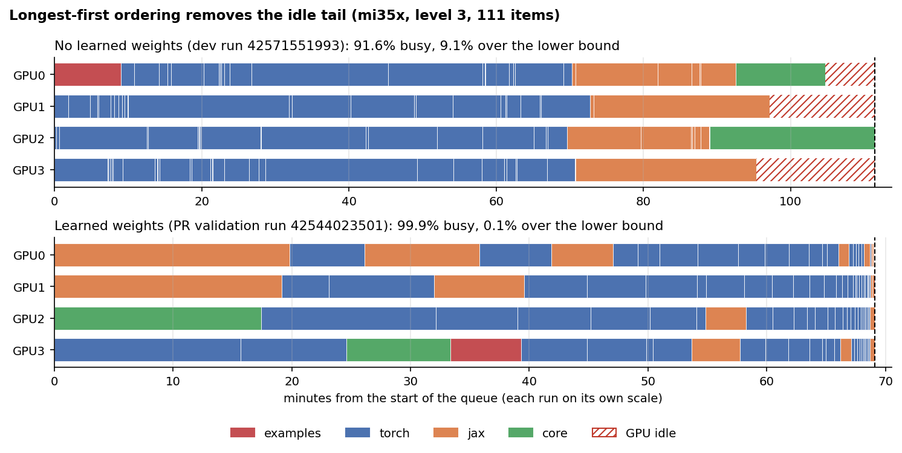

*Without weights, JAX and core start last and three GPUs idle for up to 16 min (91.6% busy).
With learned weights the four GPUs finish within seconds of each other, 0.1% over the lower bound
of total work / 4.*

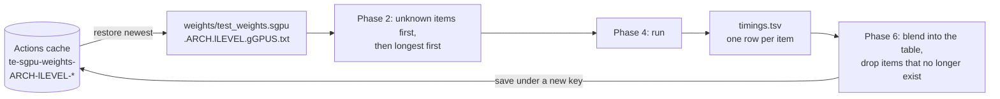

- **Key.** One table per queue, arch, `TEST_LEVEL` and GPU count, in seconds per item.
- **Update.** An exponential average that rises fast and falls slowly (`alpha` 0.5 up, 0.1 down).
  Underestimating a long item puts it at the end of the run, which costs more than starting a
  short one early.
- **What is learned.** Only complete measurements: an item cut off by a timeout, a crash or an OOM
  kill is skipped. A narrowed re-run does not update the table.
- **Unknown items.** A new item gets weight 999999, so it starts first; after one run it has a
  real weight.
- **Weights are rough, and that is fine.** In run 42544023501 only 16% of items were within 25% of
  their weight, yet the run was 99.9% busy. Only the order matters, and pulling on completion
  absorbs the rest.

No table is committed: one run per cache scope rebuilds it.

### 5.3 Setup once, probe once

The queue re-enters a suite script once per item, so anything the script does before its first
test would otherwise run ~100 times. Phase 3 and the run setup do it once instead:

| Setup | Old layout | Queue |
|---|---|---|
| CK JIT cache | built by torch and JAX, at the same time, into one directory | built once per job, before the queue |
| pip prerequisites | inside each suite's run | once per suite, before the queue |
| mxfp8 and flash-attn support probes | inside each suite's run | once per job, passed to every item (`TE_CI_SUPPORTS_*`) |

Each probe starts Python, imports TE and initialises a GPU. Probing once instead of per item cut the
time a torch item spends outside pytest from 13.6 s to 3.6 s (median, mi35x, runs 42465142212 and
42544023501): about 860 GPU-seconds per run. A suite script run on its own still sets up and probes
inline.

### 5.4 Core as two items

`ci/core.sh` builds the C++ tests, then runs ctest. It now lists two items, `nongemm` and `gemm`
(JUnit `nongemm.xml`, `gemm.xml`), so the two halves run on different GPUs. The build runs under a
lock (`build/.te_ci_build.lock`): the first item builds, the second finds the build up to date.

### 5.5 Isolation per item

Items run side by side, so each gets its own:

| Resource | How |
|---|---|
| GPU | `HIP_VISIBLE_DEVICES=<gpu>` |
| Working directory | `test-results/logs/cwd/<label>.<tag>/` (removed if left empty) |
| torchrun port | `PET_MASTER_PORT` = 29600 + GPU id |
| Log and exit code | `test-results/logs/items/<label>.<tag>.log` and `.log.rc` |
| JUnit XML | `test-results/<label>/<tag>.xml` |

A shared working directory let two items race on `./checkpoint.pt`; separate directories removed
that class of failure.

### 5.6 Re-run only what failed

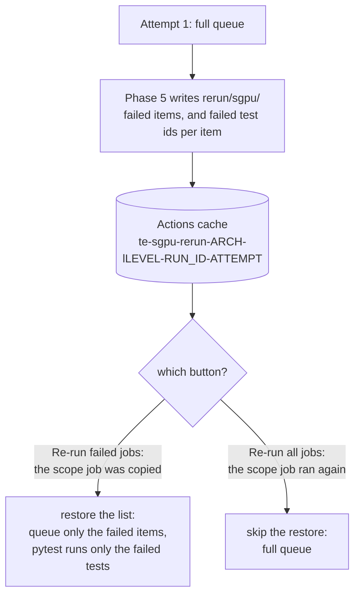

- **Item level.** Phase 5 lists the items that failed. On "Re-run failed jobs", Phase 2 queues only
  those. The workflow tells the two buttons apart by the scope job's `ran_in_attempt` output: that
  job is copied on "Re-run failed jobs" and runs again on "Re-run all jobs".
- **Test level.** A pytest plugin, [`ci/te_ci_result_sink.py`](../../te_ci_result_sink.py), records
  failing test ids; `TE_CI_ONLY_TESTS` deselects every other test on the re-run. If more than half
  of an item would re-run, or the item died before saying which tests failed, the whole item
  re-runs. Core and examples items always re-run whole.
- **Reporting.** A suite with nothing to re-run reports "Nothing to re-run", not a crash, and each
  job summary says which attempt wrote it.

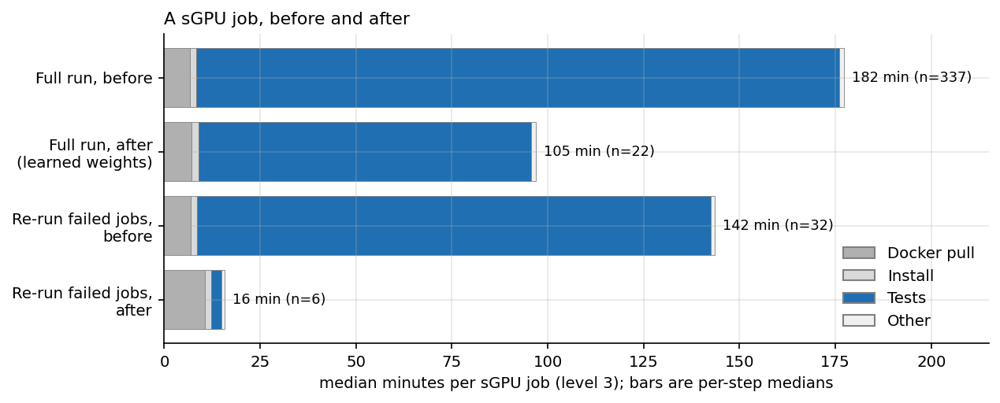

*Medians of each step, level 3. A narrowed re-run spends 3 min testing; most of its 16 min is the
Docker image pull, which the separate image PR addresses.*

On the first dev run after the merge, mi30x failed one flaky item. "Re-run failed jobs" queued that
item alone and ran its one failed test: 29 s of testing.

### 5.7 PR suite selection

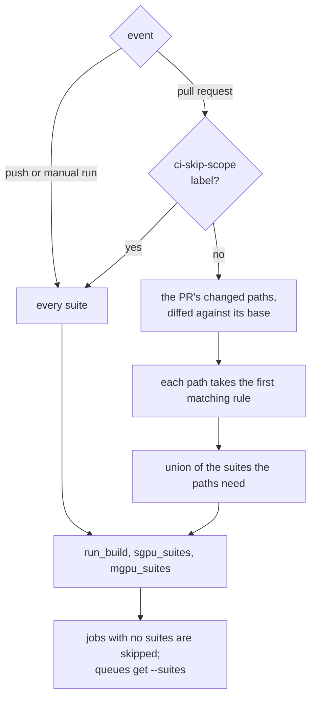

[`.github/scripts/change_scope.py`](../../../.github/scripts/change_scope.py) holds the rules,
first match wins. Documentation and lint configuration need nothing; `tests/pytorch/**` needs the
torch suites; `transformer_engine/jax/**` needs JAX and examples; the core library, the build,
`ci/**` and any path no rule names need everything. A PR is gated by its own copy of the rules, so
a PR that edits them runs everything. The scope job's summary lists the rule each path matched.

The rules only started gating at the merge, so their effect is estimated by replaying them over the
changed files of every PR that ran GPU tests before it:

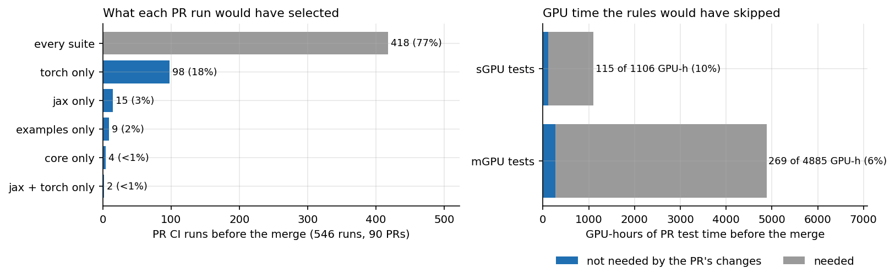

*128 of 546 PR runs (20 of 90 PRs) would have run a subset, mostly torch-only. That is 10% of the
sGPU and 6% of the mGPU GPU-hours those runs used. The PR's final file list stands in for each
run's.*

### 5.8 PR labels

[`rocm-ci-dispatch.yml`](../../../.github/workflows/rocm-ci-dispatch.yml) starts PR runs from labels:

| Event | Starts a run? | Level |
|---|---|---|
| A `ci-level N` label is added | yes | the highest `ci-level` label on the PR |
| A commit is pushed, or the PR is reopened | yes, if a `ci-level` label is present | the highest one |
| `ci-skip-scope` is added | no | while present, later runs select every suite |
| A label is removed | no | to run lower, remove the higher label first |

### 5.9 Reports

Each job summary has a section per suite, examples included, with failed and crashed tests, and a
collapsed schedule: items per GPU, utilisation, and each item's time against its weight. Every
summary starts with the attempt that wrote it, since "Re-run failed jobs" copies the summaries of
jobs it does not re-run.

### 5.10 mGPU tests

The mGPU queue uses the same engine: list mode, per-suite verdicts and re-runs of failed items and
tests. It keeps no weights, because its items run one at a time on the whole box, so order does not
change the wall time. Running mGPU items side by side on subsets of the GPUs is the separate mGPU PR.

### 5.11 Changes to the suite scripts

The suite scripts needed a few changes to be dispatched one item at a time:

- **Every call line has a unique tag.** Two JAX lines that shared a tag got labels: `smallseq` (CK
  small-seq fused attention) and `no_triton_gemm` (distributed LayerNorm MLP).
- **Work outside pytest belongs to an item.** The checkpoint artifact is made only by the
  `test_checkpoint` item that reads it, and the level 3 attention benchmark is an item of its own.
- **Capability checks are shared.** `check_supported mxfp8` and `check_supported flash_attn` in
  `ci/_utils.sh` replace per-script copies and read the job-wide answer.
- **Two tests moved from the mGPU job to the sGPU queue.** `test_fused_optimizer.py` and
  `test_gemm_sm_count.py` use one GPU. The second compares GEMM time with and without an SM limit,
  and ran in the mGPU job only to stay away from the parallel sGPU tests. It now times on the GPU,
  with its launches queued behind a busy-wait, and compares the fastest of 7 alternating samples,
  so load elsewhere on the box no longer skews it. Its assertion is unchanged.

## 6. Results in production

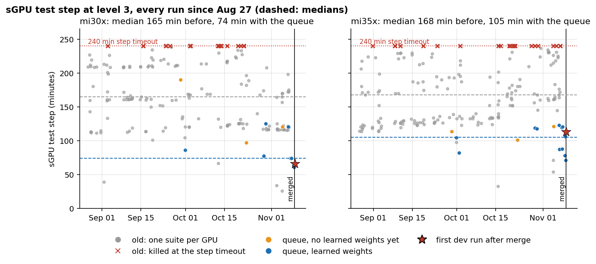

*Grey: the old layout; red crosses: runs killed at the 240 min step timeout. Orange and blue: queue
runs, mostly this PR's validation runs before the merge. Star: the first dev run after it. Dashed:
medians; the queue median is over runs with learned weights.*

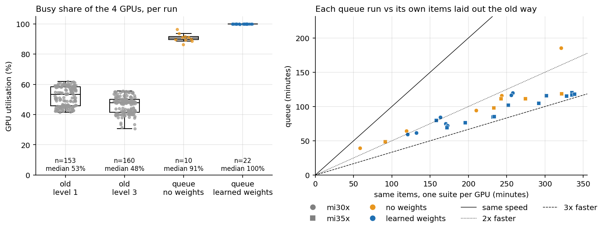

*Left: the share of GPU time spent testing. Right: each queue run's wall clock against the same
items laid out one suite per GPU; points below the 2x line are more than twice as fast.*

The first dev push after the merge, run
[42571551993](https://github.com/ROCm/TransformerEngine/actions/runs/42571551993) (level 3):

| | mi30x | mi35x |
|---|---|---|
| Items | 109 | 111 |
| Queue wall clock | 65 min | 111 min |
| Same items laid out the old way | 119 min | 274 min |
| GPUs busy | 89.9% | 91.6% |
| Weights | none: first run on `dev` | none: first run on `dev` |
| Re-run | 1 flaky item: 1 test, 29 s | not needed |

Push to last GPU job took 2.9 h; the median of the 74 dev pushes before was 4.9 h. Caches are
scoped to their branch, so `dev` started without the weights the PR branch had learned. This run
wrote them, and later `dev` runs start ordered.

Reading the numbers:

- **Machines vary.** In the week before the merge, the same 111 items took between 276 and 483
  GPU-minutes on different mi35x runners. Compare a run with its own items laid out the old way, or
  utilisation, rather than minutes across runs.
- **Before and after are different weeks**, and the test suites grew in between. The same-work
  comparison does not depend on that.

## 7. Operating notes

### 7.1 Running locally

Inside a TE CI container, from the repo root (bash 5.1+, `rocminfo`, `python3` with pandas):

```sh
TEST_LEVEL=1 ci/run_queue.sh                                 # sGPU tests on every visible GPU
HIP_VISIBLE_DEVICES=0,1 TEST_LEVEL=1 ci/run_queue.sh         # only these GPUs
TEST_LEVEL=1 ci/run_queue.sh --suites "torch core"           # only these suites
TEST_LEVEL=3 ci/run_queue.sh --queue mgpu                    # mGPU tests on the whole box
TEST_LEVEL=1 TEST_SGPU=1 TEST_FILTER=test_numerics.auto ci/pytorch.sh   # one item, no queue
```

After a run with failures, the next run queues only the failed items; delete `ci-data/rerun/` to run
everything. The suite scripts still run on their own exactly as before.

### 7.2 Data layout

```
ci-data/                         TE_CI_DATA_DIR
├── weights/                     learned item durations (sGPU queue)
├── rerun/<queue>/               failed items, and failed test ids per item
└── test-results/
    ├── <suite>/<tag>.xml        JUnit XML per item
    └── logs/
        ├── items/               one log and exit code per item
        ├── suites/              per-suite verdict and an index of its items
        ├── report/schedule.md   the schedule report
        ├── queue/               queue.tsv, items.tsv, timings.tsv
        ├── cwd/                 per-item working directories
        └── prerequisite_ck_jit_status/   setup logs
```

### 7.3 Caches

| Cache | Key | Restored | Effect if missing |
|---|---|---|---|
| weights | `te-sgpu-weights-<arch>-l<level>-<run_id>-<attempt>` | newest with the same arch and level | the run is unordered, never wrong |
| sGPU re-run list | `te-sgpu-rerun-<arch>-l<level>-<run_id>-<attempt>` | same run only, on "Re-run failed jobs" | the re-run queues everything |
| mGPU re-run list | `te-mgpu-rerun-<arch>-l<level>-<run_id>-<attempt>` | as above | as above |

Actions caches are scoped to their branch: a PR reads its own and its base branch's, `dev` reads
only its own. GitHub evicts caches unused for 7 days. The files are a few KB.

### 7.4 Timeouts

| Job | Job timeout | Test step timeout |
|---|---|---|
| sGPU Tests | 270 min | 240 min |
| mGPU Tests | 240 min | 180 min |

Inside the queue, `PYTEST_TIMEOUT` bounds each test and `CTEST_TIMEOUT` each C++ test; the queue
adds no limit of its own. The step timeout sits below the job's, so the report and log upload still
run after an overrun.

### 7.5 Where to look

| Question | Where |
|---|---|
| What failed? | the job summary, or the job log's `== N of M items FAILED ==` |
| Why? | `logs/items/<label>.<tag>.log` in the `logs-sgpu-<arch>` artifact |
| Was the schedule good? | the job summary's schedule section, or `logs/report/schedule.md` |
| What will the next run assume? | `ci-data/weights/test_weights.*.txt` |
| Why did a PR skip a suite? | the "Select Test Suites" job summary |

## 8. Limitations and next steps

- **A new cache scope starts unordered.** The first run on a branch, or after 7 days without a run,
  is 86–96% busy instead of ~100%. It writes the weights for the next run.
- **The image pull dominates a narrowed re-run**: 10 of 16 min. A slimmer image (separate PR)
  downloads 5.5 GB instead of 9.7 GB, measured on a local build.
- **mGPU items run one at a time on the whole box.** Running them side by side is the separate
  mGPU PR.
- **A flaky test still fails the job.** A re-run now costs ~16 min, but it is still manual.
- **A faulty GPU is not detected.** Its items fail quickly, and the queue keeps handing it work.
- **Machine speed varies** by up to 1.75x for the same items between runners of one pool, and the
  queue's wall clock follows it.

## Appendix A. Methodology

Data comes from the GitHub Actions API: every run of `rocm-ci.yml` (pushes, manual runs) and
`rocm-ci-dispatch.yml` (pull requests) created since 2026-08-01, the jobs of every attempt, the log
of every sGPU job, and the changed files of every PR that ran GPU tests.
[`tools/collect_ci_data.py`](tools/collect_ci_data.py) fetches and parses them into
[`data/`](data); [`tools/make_figures.py`](tools/make_figures.py) draws the figures and writes
[`data/summary.json`](data/summary.json), the numbers quoted here:

```sh
pip install pandas requests matplotlib
GH_TOKEN=<token> python3 tools/collect_ci_data.py --since 2026-08-01
python3 tools/make_figures.py
```

Definitions:

- **Old and new runs** are told apart by the sGPU test step's name, not by date: PR #696's own
  validation runs used the queue before the merge, and other PRs used the old layout until then.
- **Test step**: the duration of the "Run sGPU tests" step, setup included; a full job adds the
  image pull, installs and reporting. Steps under 20 min (setup failures) and narrowed re-runs are
  left out of full-run statistics.
- **Utilisation**: GPU-seconds spent in work items / (GPUs × wall clock from the first item's start
  to the last item's end). Old layout: from each suite's start and finish time in the job log.
- **Same items laid out the old way**: per suite, the sum of its items' durations in the queue run;
  the longest suite is the old wall clock. Setup is left out, which favours the old layout.
- **Lower bound**: max(total item time / GPUs, longest item).
- **Learned weights or not**: whether the queue log printed an estimate for most items.
- **Re-runs**: an sGPU job that ran in attempt > 1. It counts as narrowed if the scope job did not
  run again in that attempt; narrowed re-runs are counted from 2026-11-01, the final
  implementation.
- **PR suite selection**: `change_scope.scope()` over the PR's final changed files, old names of
  renames included. sGPU savings: the measured durations of the suites it would have skipped. mGPU:
  the old per-framework job's test step × 8 GPUs.
- **Probe overhead**: an item's wall time minus the session time pytest reports, from the item logs
  of the two runs' `logs-sgpu-mi35x` artifacts.

## Appendix B. Environment variables

| Variable | Set by | Effect |
|---|---|---|
| `TE_CI_DATA_DIR` | workflow, user | root of weights, re-run lists and results (default `ci-data`) |
| `TE_CI_SUITES` | workflow | the suites to run, as `--suites` |
| `TEST_FILTER` | queue, user | run only the call lines whose tag matches one of these glob patterns |
| `TE_CI_LIST_ITEMS` | queue | print `TE_CI_ITEM <tag>` per call line instead of running it |
| `TE_CI_SKIP_CHECK_SUPPORTED` | queue | list items as if every capability were present (the census) |
| `TE_CI_SETUP_ONLY` | queue | run the suite's setup, then exit |
| `TE_CI_SKIP_SETUP` | queue | skip pip setup and the CK JIT prebuild |
| `TE_CI_SKIP_CK_JIT` | queue | skip the CK JIT prebuild |
| `TE_CI_SUPPORTS_MXFP8`, `TE_CI_SUPPORTS_FLASH_ATTN` | queue | probe answers shared by every item |
| `TE_CI_ONLY_TESTS` | queue | file of test ids; pytest deselects the rest |
| `TE_CI_DEFAULT_WEIGHT` | user | weight of an unknown item (default 999999) |
| `TE_CI_PORT_BASE` | user | base of the per-item torchrun port (default 29600) |

## Appendix C. Files

| File | Role |
|---|---|
| [`ci/run_queue.sh`](../../run_queue.sh) | the queue: phases 0–8 |
| [`ci/ci_sgpu_queue.conf`](../../ci_sgpu_queue.conf), [`ci/ci_mgpu_queue.conf`](../../ci_mgpu_queue.conf) | suites per queue |
| [`ci/_utils.sh`](../../_utils.sh) | list mode, filters, setup hooks, probe cache, result sink wiring |
| [`ci/scheduler/build_weights.py`](../../scheduler/build_weights.py) | order the queue, update the weights |
| [`ci/scheduler/rerun_tests.py`](../../scheduler/rerun_tests.py) | which failed items re-run as single tests |
| [`ci/scheduler/schedule_report.py`](../../scheduler/schedule_report.py) | the schedule report |
| [`ci/te_ci_result_sink.py`](../../te_ci_result_sink.py) | pytest plugin: crash-safe results, failed test ids, test-level re-runs |
| [`ci/junit_report.py`](../../junit_report.py) | per-suite job summary sections |
| [`.github/scripts/change_scope.py`](../../../.github/scripts/change_scope.py) | PR suite selection rules |
| [`.github/scripts/run_example.py`](../../../.github/scripts/run_example.py) | one example, with a JUnit result |
| [`.github/workflows/rocm-ci.yml`](../../../.github/workflows/rocm-ci.yml) | the CI workflow |
| [`.github/workflows/rocm-ci-dispatch.yml`](../../../.github/workflows/rocm-ci-dispatch.yml) | PR label dispatch |
